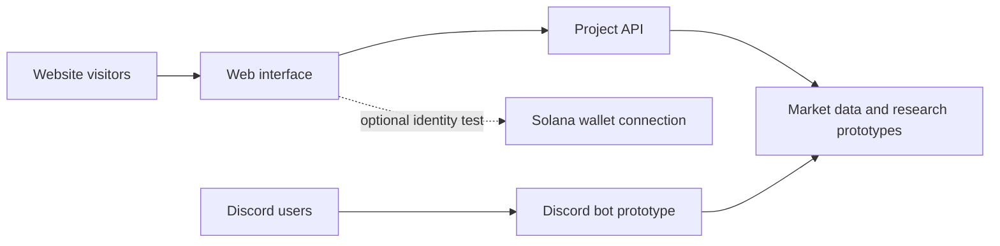

# Architecture: current project view

SynaptoBot AI is under active development. The public website and assistant are previews; this document describes broad components, not a production guarantee or a complete security specification.

## Boundaries

- Market data may be delayed, unavailable, or incorrect. Each displayed timestamp and source should be checked before relying on a value.
- Signal and research features are informational prototypes. They do not place trades or promise results.
- Wallet connection supports interface and identity testing. No staking, token distribution, or transaction flow is represented as active here.
- The assistant is experimental; availability, accuracy, model configuration, and usage limits can change.
- This public repository contains documentation. It does not contain application code, deployment secrets, private user data, or production credentials.

## Before a production claim

Any future production feature needs a documented scope, operational monitoring, security review, failure handling, privacy notice, and verification appropriate to that feature. Until then, preview labels take precedence over mockups or aspirational descriptions.
